<div align="center">

<!-- ══════════════════ HEADER: TERMINAL DESCRIPTOGRAFANDO ══════════════════ -->


<!-- TYPING EFFECT -->
<a href="https://git.io/typing-svg">
  
</a>

<!-- BADGES DE CONTATO -->
<p>
  <a href="https://linkedin.com/in/cassio-bona-653669229/">
    
  </a>
  <a href="mailto:caeulalio2608@gmail.com">
    
  </a>
  
</p>


</div>

---

## 🌸 Sobre mim

```yaml
nome:      Cassio Bona Eulalio
foco:      DevOps • Backend • Cibersegurança
estudo:    Ciência da Computação @ AFYA São Lucas (2028)
trabalho:  Estagiário DevOps @ SEDAM (GERDES) — GOVCLIMA
paixao:    Automação, infraestrutura como código, CTF e anime
idiomas:   Português (nativo) • Inglês (intermediário)
```

> _"Eu não paro. Não desisto. Se cair, eu levanto."_
> — a energia de todo protagonista que treina até sangrar.

Atualmente construindo pipelines de **observabilidade** para dados ambientais do governo,
quebrando CTFs no tempo livre e automatizando tudo que dá pra automatizar.
Apaixonado por ir fundo no metal — de um hook no kernel a um dashboard no Grafana.

---

## ⚔️ Arsenal Técnico

### 💻 Linguagens
<p align="left">
  
</p>

### ☁️ DevOps & Observabilidade
<p align="left">
  
</p>

### 🛡️ Segurança & Ferramentas
<p align="left">
  
</p>

<details>
<summary><b>🧰 Stack completa (clica aí)</b></summary>
<br>

| Categoria | Ferramentas |
| :--- | :--- |
| **Linguagens** | JavaScript (Node.js), Python, SQL, C, HTML/CSS |
| **DevOps & Orquestração** | Docker, Docker Compose, Kubernetes (RKE2, k3s), Terraform, Helm, Traefik Ingress |
| **Observabilidade** | Prometheus, Grafana, Loki, cAdvisor |
| **Segurança** | Nmap, Web Scraping (Python), análise de vulnerabilidades |
| **Backend & Dados** | Node.js, PostgreSQL, Playwright (E2E), N8N, Postman |
| **Sistemas** | Linux (Debian, Ubuntu) |

</details>

---

## 🎓 Educação & Certificações

<table>
<tr>
<td align="center"></td>
<td><b>Ciência da Computação</b> — AFYA São Lucas<br/><sub>Mar 2025 – 2028 (previsão)</sub></td>
</tr>
<tr>
<td align="center"></td>
<td><b>Introduction to Kubernetes (LFS158)</b> — Linux Foundation</td>
</tr>
<tr>
<td align="center"></td>
<td><b>Nmap Network Analysis</b> — Hack The Box Academy</td>
</tr>
</table>

---

## 🏆 Conquistas

<div align="center">

### 🥉 3º Lugar — Capture The Flag (CTF)
**Conexão Tech — SETIC** · *Nov 2026* · Porto Velho, RO

Desafios de **forense digital** e **análise de logs**: investigação de artefatos, correlação de eventos e resposta a incidentes.


</div>

---

<div align="center">

**Cassio Bona Eulalio** · Porto Velho, RO · Brasil

<a href="https://linkedin.com/in/cassio-bona-653669229/">LinkedIn</a> ·
<a href="mailto:caeulalio2608@gmail.com">caeulalio2608@gmail.com</a> ·
(69) 98116-2676

</div>
